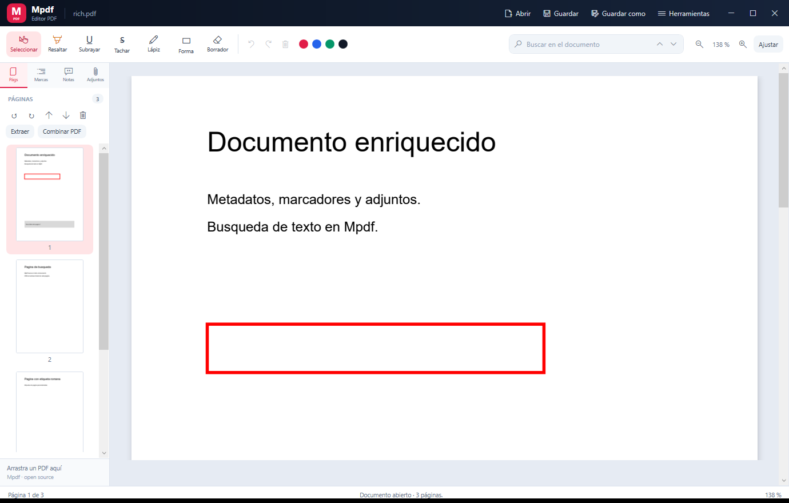

# Mpdf

Editor de PDF gratuito y de código abierto para Windows, con una interfaz moderna inspirada en Adobe Acrobat. Usa [PDFium](https://pdfium.googlesource.com/pdfium/) como motor de renderizado y escritura.



## Descargar

[**MpdfSetup.exe**](https://github.com/montyxace-sys/Mpdf/releases/latest/download/MpdfSetup.exe) · instalador para Windows 10/11 de 64 bits. Incluye la aplicación, PDFium y todo lo necesario; no requiere conexión a Internet.

¿Prefieres no instalar nada? Descarga [Mpdf.exe](https://github.com/montyxace-sys/Mpdf/releases/latest/download/Mpdf.exe) y ejecútalo directamente.

## Funciones

### Visor y navegación
- Abrir PDF (también protegidos con contraseña) y arrastrar archivos sobre la ventana.
- Zoom, ajustar al ancho, miniaturas y etiquetas de página del documento.
- Pantalla completa sin distracciones (F11).
- Búsqueda incremental con resaltado de coincidencias; F3 y Mayús+F3 para navegar.
- Panel lateral con páginas, marcadores anidados, comentarios y adjuntos.

### Anotaciones
- Resaltar, subrayar, tachar, lápiz, rectángulos y borrador.
- Paleta de colores y grosor de trazo.
- Las marcas se guardan como anotaciones reales del PDF y se pueden deshacer y rehacer.
- Guardado atómico (archivo temporal y reemplazo) para no corromper el original.

### Páginas
- Insertar página en blanco del mismo tamaño que la actual.
- Insertar las páginas de otro PDF en la posición elegida.
- Mover, girar y eliminar páginas.
- Extraer un rango de páginas a un PDF nuevo.
- Dividir el documento en varios PDFs cada N páginas.
- Combinar varios PDFs en uno.
- Girar todas las páginas a la vez en cualquier dirección.

### Estampado y exportación
- Numeración de páginas con formato personalizable, número inicial, posición, tamaño y color.
- Marca de agua de texto con tamaño, opacidad, ángulo y color; se adapta a páginas verticales, giradas y de distinto tamaño.
- Exportar páginas o rangos como imágenes PNG o JPEG a 72, 150 o 300 ppp, incluyendo marcas y anotaciones.

### Documento
- Propiedades del documento: tamaño, versión, metadatos, cifrado, permisos, marcadores y adjuntos.
- Abrir o guardar archivos adjuntos incrustados.
- Copiar el texto de una página o exportar el texto de todo el documento.

### Productividad
- Paleta de comandos con Ctrl+K.
- Atajos: Ctrl+O, Ctrl+S, Ctrl+Mayús+S, Ctrl+Z, Ctrl+Y, Ctrl+F, Ctrl+0, Ctrl+«+», Ctrl+«-», F11, Esc.

## Requisitos

- Windows 10 u 11 de 64 bits.
- [.NET 8 SDK](https://dotnet.microsoft.com/download/dotnet/8.0) para compilar.
- Node.js solo si quieres regenerar los PDFs de prueba.

## Compilar y ejecutar

```powershell
dotnet build Mpdf.csproj -c Release
dotnet run --project Mpdf.csproj
```

Para generar un ejecutable autocontenido:

```powershell
dotnet publish Mpdf.csproj -c Release -r win-x64 --self-contained true -p:PublishSingleFile=true -p:IncludeNativeLibrariesForSelfExtract=true
```

`IncludeNativeLibrariesForSelfExtract` guarda PDFium y las librerías nativas de WPF dentro de `Mpdf.exe`, de modo que el archivo funciona aunque se copie solo a otra carpeta.

## Instalador

El instalador solicita permisos de administrador e instala Mpdf para todos los usuarios en `C:\Program Files\Mpdf`. Permite elegir la carpeta y activar o desactivar los accesos directos del escritorio y del menú Inicio, la asociación de archivos `.pdf` y la ejecución como administrador (opcional; desactiva arrastrar y soltar archivos sobre la ventana). Añade la entrada en Aplicaciones instaladas y un desinstalador propio, y muestra el progreso con porcentaje real.

```powershell
.\build-setup.ps1
```

Genera `publish\Mpdf.exe` y `publish\MpdfSetup.exe`. El instalador incluye la aplicación y sus librerías nativas comprimidas, y no necesita conexión a Internet.

## Pruebas del motor

Las pruebas cubren renderizado, búsqueda, anotaciones, rotación, combinación, extracción, división, deshacer/rehacer, numeración, marcas de agua (también en páginas giradas), exportación de imágenes, metadatos, marcadores, adjuntos y extracción de texto.

```powershell
node test/make-test-pdfs.js
dotnet run --project tests/Mpdf.EngineTests
```

Resultado actual: 138 comprobaciones, 0 fallos.

Las pruebas del instalador comprueban la instalación en una carpeta temporal con registro aislado: extracción de archivos, accesos directos, asociaciones, entrada de desinstalación, ejecución como administrador, porcentaje de progreso y limpieza completa.

```powershell
dotnet build tests/Mpdf.InstallerTests/Mpdf.InstallerTests.csproj -c Release
tests/Mpdf.InstallerTests/bin/Release/net48/Mpdf.InstallerTests.exe
```

Resultado actual: 39 comprobaciones, 0 fallos.

## Estructura

```
Controls/    Vistas, diálogos y la página interactiva
Models/      Modelos de página, anotaciones e información del documento
Services/    Sesión del documento y enlaces P/Invoke con PDFium
Styles/      Tema y estilos WPF
Installer/   Instalador y desinstalador (WPF para .NET Framework 4.8)
test/        Generador de PDFs de prueba y utilidades de verificación
tests/       Pruebas del motor y del instalador
```

## Limitaciones conocidas

- Las propiedades del documento se muestran en modo lectura; esta integración de PDFium no permite escribir metadatos.
- No se pueden guardar documentos cifrados ni cambiar contraseñas o permisos.
- Sin OCR, formularios, capas, firmas digitales ni redacción real.
- Sin vista de dos páginas, rotación de vista, temas oscuros ni tamaño de miniatura ajustable.
- Sin recuperación automática tras un cierre inesperado.
- Solo Windows x64.

## Agradecimientos

- **PDFium** (Chromium Project, licencia BSD-3) por el motor PDF.
- **PDFCraft** (MIT OR Apache-2.0) y **Stirling PDF** por servir de referencia en la organización de herramientas.
- **Adobe Acrobat** por la inspiración visual.

Mpdf no está afiliado a Adobe, PDFCraft ni Stirling PDF.

## Licencia

MIT © 2026 MSoft. Consulta [LICENSE](LICENSE).
